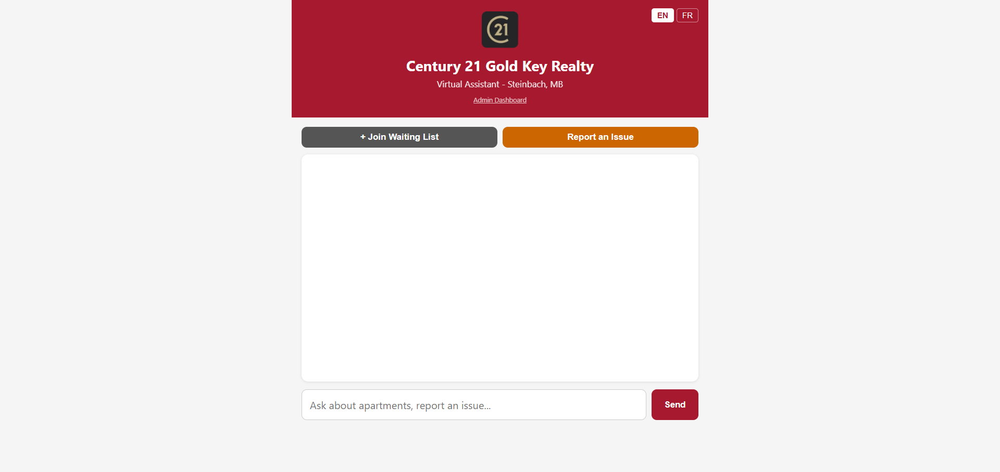
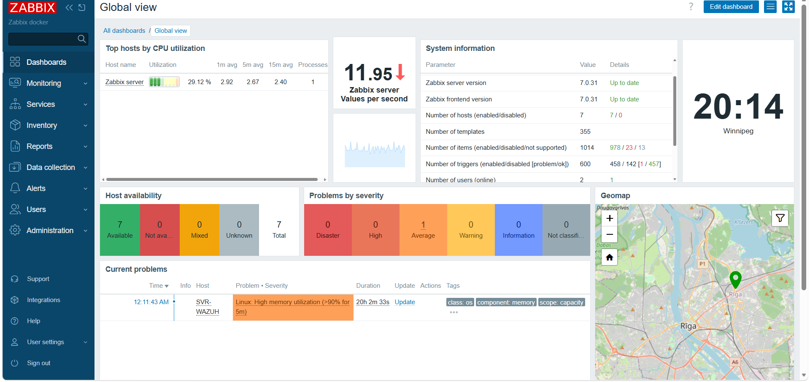
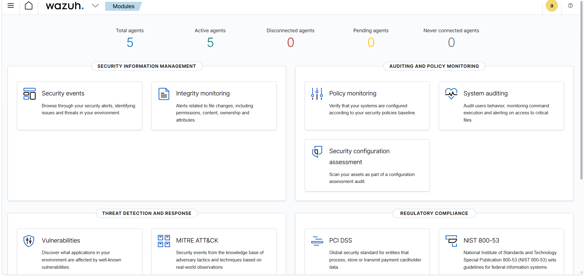
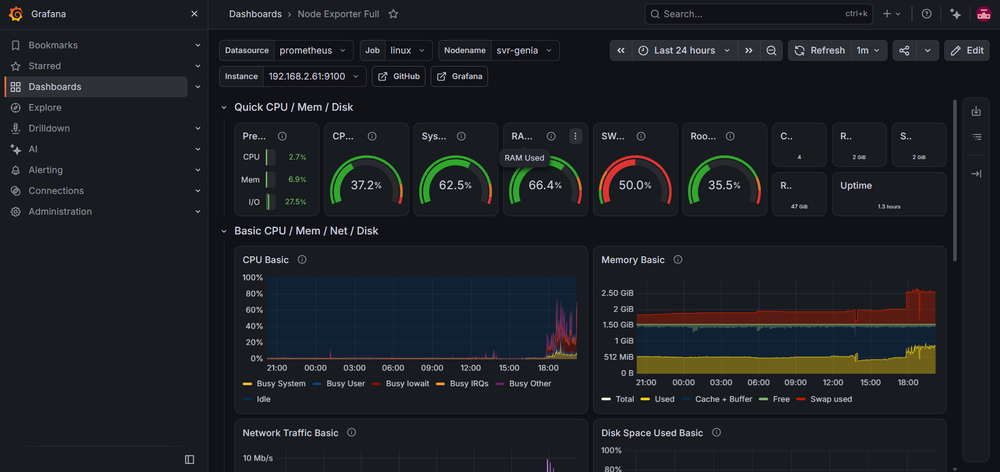
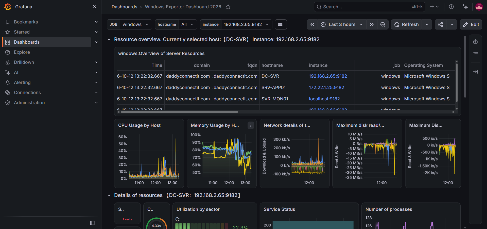
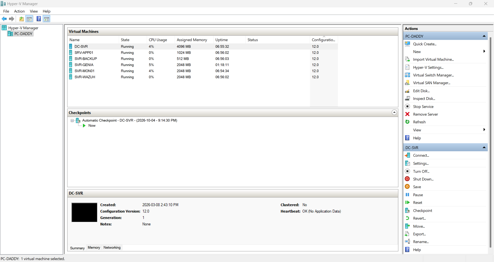

# genia-c21

Assistant virtuel de **Century 21 Gold Key Realty** (Steinbach, MB) : réponses aux questions sur les logements, liste d'attente, signalement de problèmes, tableau de bord d'administration. Interface bilingue (EN / FR).

Le dépôt contient l'application (Python, servie par Gunicorn sur le port 5000) et sa documentation d'exploitation : déploiement Docker, tunnel Cloudflare et supervision.



## Sommaire

1. [Architecture](#architecture)
2. [Contenu du dépôt](#contenu-du-dépôt)
3. [Déploiement avec Docker Compose](#déploiement-avec-docker-compose)
4. [Accès public : tunnel Cloudflare](#accès-public--tunnel-cloudflare)
5. [Déploiement Kubernetes](#déploiement-kubernetes)
6. [Infrastructure hôte](#infrastructure-hôte)
7. [Supervision](#supervision)
8. [Sécurité](#sécurité)
9. [Exploitation courante](#exploitation-courante)
10. [Reste à faire](#reste-à-faire)

## Architecture
Internet
│ HTTPS 443
▼
Cloudflare (DNS, WAF, tunnel)
│ connexion sortante seulement (aucun port entrant ouvert)
▼
cloudflared ──► conteneur genia-c21 (Gunicorn, port 5000)


- **Aucun port n'est exposé sur Internet.** Le service `cloudflared` ouvre une connexion sortante vers Cloudflare, qui relaie le trafic vers l'application.
- L'application tourne dans un conteneur Docker, sur une machine virtuelle Ubuntu (Hyper-V).
- Un réseau privé ZeroTier donne l'accès d'administration (SSH, tableaux de bord) sans rien publier.

Une vue d'ensemble de l'infrastructure (machines virtuelles, réseaux, flux de supervision) est dans les sections [Infrastructure hôte](#infrastructure-hôte) et [Supervision](#supervision).

## Contenu du dépôt

| Fichier | Rôle |
| --- | --- |
| `app.py` | Application principale |
| `buildings_data.py` | Données des immeubles |
| `requirements.txt` | Dépendances Python |
| `Dockerfile` | Image de l'application |
| `docker-compose.yml` | Lancement du conteneur |
| `get-docker.sh` | Installation de Docker (script d'amorçage) |
| `k8s-deployment.yaml` | Déploiement Kubernetes |
| `k8s-ingress.yaml` | Ingress Kubernetes |
| `k8s-secret.example.yaml` | Modèle de secret (sans valeurs réelles) |
| `patch_*.py` | Scripts de correctifs ponctuels |
| `docs/screenshots/` | Captures de la documentation |

## Déploiement avec Docker Compose

Prérequis : Docker et le plugin Compose (`get-docker.sh` les installe sur Ubuntu).

```bash
git clone https://github.com/daddy2412/genia-c21.git
cd genia-c21

# Variables d'environnement : À COMPLÉTER (voir docker-compose.yml)
# cp .env.example .env && nano .env

docker compose up -d --build
docker compose ps
docker compose logs --tail 50
```

L'application écoute sur le port **5000**. Test local :

```bash
curl -I http://localhost:5000
```

Le conteneur doit redémarrer seul après un redémarrage de la machine. Vérifier la présence de `restart: unless-stopped` dans `docker-compose.yml`, et que le service Docker démarre au boot :

```bash
sudo systemctl enable docker
```

### Réseau Docker

Si le réseau par défaut de Docker (`172.17.0.0/16`) chevauche un réseau existant, déplacer le pont par défaut :

```bash
sudo tee /etc/docker/daemon.json > /dev/null <<'EOF'
{
  "bip": "10.200.0.1/24"
}
EOF
sudo systemctl restart docker
```

Les conteneurs sont redémarrés avec Docker.

## Accès public : tunnel Cloudflare

Le site est publié sur `c21assistant.daddyconnectit.com` par un tunnel Cloudflare (`cloudflared`), installé comme **service système** sur la machine virtuelle.

### Pourquoi une surcharge de service

Le service livré arrête `cloudflared` s'il met plus de 15 secondes à se connecter, ce qui arrive au démarrage quand le réseau n'est pas prêt (erreur Cloudflare 1033). La surcharge suivante règle le problème :

```bash
sudo mkdir -p /etc/systemd/system/cloudflared.service.d
sudo tee /etc/systemd/system/cloudflared.service.d/override.conf > /dev/null <<'EOF'
[Unit]
After=network-online.target
Wants=network-online.target

[Service]
TimeoutStartSec=0
Restart=always
RestartSec=10
EOF
sudo systemctl daemon-reload
sudo systemctl enable cloudflared
```

### Vérifications

```bash
systemctl cat cloudflared | tail -10        # la surcharge doit apparaître
systemctl is-active cloudflared             # active
sudo journalctl -u cloudflared -n 20 --no-pager | grep -E "Registered|WRN|ERR"
```

Quatre lignes « Registered tunnel connection » indiquent un tunnel sain. Dans le tableau de bord Cloudflare Zero Trust (Réseaux, Tunnels), le statut doit être **Sain**.

### Alerte de santé

Configurer dans Cloudflare une alerte sur l'état du tunnel (Notifications) pour être prévenu si le tunnel passe en panne.

## Déploiement Kubernetes

Les manifestes `k8s-*.yaml` permettent un déploiement sur un cluster Kubernetes.

```bash
# 1. Créer le secret à partir du modèle (ne jamais committer la version remplie)
cp k8s-secret.example.yaml k8s-secret.yaml
nano k8s-secret.yaml

# 2. Appliquer
kubectl apply -f k8s-secret.yaml
kubectl apply -f k8s-deployment.yaml
kubectl apply -f k8s-ingress.yaml
kubectl get pods,svc,ingress
```

Ajouter `k8s-secret.yaml` au fichier `.gitignore`.

## Infrastructure hôte

L'application tourne sur une machine virtuelle Ubuntu (Docker) d'un laboratoire hébergé sur un hôte Windows avec Hyper-V. Six machines virtuelles, dans un domaine Active Directory :

| Machine virtuelle | Système | Rôle |
| --- | --- | --- |
| `svr-genia` | Ubuntu | Application `genia-c21` (Docker), tunnel Cloudflare, serveur Zabbix |
| `SVR-WAZUH` | Ubuntu | Wazuh : manager, indexer, dashboard |
| `SVR-MON01` | Windows Server | Prometheus, Grafana, Loki, Alloy |
| `DC-SVR` | Windows Server | Contrôleur de domaine (Active Directory) |
| `SRV-APP01` | Windows Server | Applications |
| `SVR-BACKUP` | Windows Server | Sauvegardes |

**Réseau** : un réseau interne pour la supervision (agents Wazuh, Zabbix, exporters) et un réseau privé ZeroTier pour l'administration (SSH, tableaux de bord). Aucun port n'est ouvert sur Internet.

> Les adresses IP internes, les noms d'hôtes physiques et la topologie détaillée ne sont volontairement pas publiés dans ce dépôt.

## Supervision

L'infrastructure est supervisée par quatre outils complémentaires.

| Outil | Rôle |
| --- | --- |
| **Zabbix** | Disponibilité et alertes des machines (agents, modèles Linux et Windows) |
| **Wazuh** | Sécurité : SIEM, intégrité des fichiers, détection de comportements suspects |
| **Prometheus + Grafana** | Métriques et tableaux de bord (Node Exporter, Windows Exporter) |
| **Loki + Alloy** | Collecte et consultation des journaux Windows (SVR-MON01) |

### Zabbix

Sept hôtes disponibles. Les alertes de bruit (changement de vitesse des cartes réseau virtuelles) sont désactivées dans les modèles Linux et Windows ; seules restent les alertes utiles (bande passante, erreurs, lien coupé, mémoire, services).



### Wazuh

Cinq agents actifs (quatre Windows, un Linux) et le serveur.



#### Détection par fichiers leurres

Un dossier leurre (`C:\Canary`) est surveillé en temps réel par la surveillance d'intégrité des fichiers (FIM). Toute création, modification ou suppression déclenche une alerte de niveau 12 (règle `100100`). Ce mécanisme **détecte** un comportement de type rançongiciel sur un dossier piège ; il ne remplace ni une sauvegarde ni un antivirus.

Règle dans `/var/ossec/etc/rules/local_rules.xml` (serveur Wazuh) :

```xml
<group name="syscheck,ransomware,">
  <rule id="100100" level="12">
    <if_sid>550,553,554</if_sid>
    <field name="file" type="pcre2">(?i)canary</field>
    <description>Fichier leurre modifié, créé ou supprimé : possible rançongiciel</description>
  </rule>
</group>
```

Directive dans `ossec.conf` de l'agent, dans le bloc `<syscheck>` :

```xml
<directories check_all="yes" realtime="yes">C:\Canary</directories>
```

Test : créer, modifier puis supprimer un fichier dans le dossier, puis rechercher `rule.id:100100` dans le tableau de bord. Les trois événements (added, modified, deleted) doivent apparaître en moins d'une minute. Le test a été validé sur un agent Windows.

> Seul l'agent où la directive est ajoutée est surveillé. Répéter la configuration sur chaque machine à couvrir.

### Prometheus et Grafana

| Cible | Port | Machines |
| --- | --- | --- |
| Node Exporter | 9100 | Linux |
| Windows Exporter | 9182 | Windows |





Après un changement d'adresse d'une machine, mettre à jour `prometheus.yml`, valider puis redémarrer :

```powershell
promtool check config C:\prometheus\prometheus.yml
Restart-Service Prometheus
```

Puis recharger la page **Status → Targets** de Prometheus : les cibles doivent être en **UP**. Dans Grafana, choisir la nouvelle valeur de la variable **Instance** du tableau de bord.

### Mémoire des machines virtuelles

Le serveur Wazuh (indexer, manager et dashboard) est limité à 2 Go de RAM, ce qui déclenche l'alerte « High memory utilization » de Zabbix. Un fichier de swap de 2 Go a été ajouté (`/swapfile2`, `vm.swappiness=10`) en attendant une extension de mémoire de l'hôte. Surveiller `free -h`.

## Sécurité

- **Aucun port entrant** : l'accès public passe par le tunnel Cloudflare (connexion sortante).
- **SSH par clé** (authentification par mot de passe à désactiver une fois les clés vérifiées). L'accès d'administration passe par un réseau privé ZeroTier.
- **Secrets** : ne jamais committer de jetons (tunnel Cloudflare, clés d'API, mots de passe). Utiliser des variables d'environnement ou `k8s-secret.yaml` exclu du dépôt. Le jeton du tunnel doit pouvoir être renouvelé depuis le tableau de bord Cloudflare si besoin.
- **Dépôt public** : n'y mettre que des captures recadrées. Masquer ID de tunnel, ID de compte, adresses IP publiques, noms d'utilisateurs et onglets du navigateur.
- **Wazuh, politique CIS** : le contrôle de configuration (SCA) d'un serveur Windows donne un score d'environ 36 % tant qu'aucun durcissement n'est appliqué. C'est un point de départ pour un plan de durcissement.

## Exploitation courante

```bash
# État de l'application
docker compose ps
docker compose logs --tail 100 genia-c21

# Redéploiement après une modification
git pull
docker compose up -d --build

# Tunnel
systemctl status cloudflared --no-pager
sudo journalctl -u cloudflared -n 30 --no-pager

# Après un redémarrage de la machine : vérifications
systemctl is-active cloudflared
docker ps
ip -br a
```

Test de panne du tunnel (le service doit revenir seul en environ 10 secondes) :

```bash
sudo systemctl kill cloudflared; sleep 15; systemctl is-active cloudflared
```

## Reste à faire

- [ ] Compléter la section variables d'environnement (`À COMPLÉTER`)
- [ ] Étendre le dossier leurre Wazuh aux autres agents
- [ ] Configurer l'envoi de courriel pour la règle `100100`
- [ ] Étendre la RAM de l'hôte (alertes mémoire du serveur Wazuh)
- [ ] Terminer l'inventaire automatique Zabbix (sept hôtes)
- [ ] Automatiser la sauvegarde des machines virtuelles
- [ ] Désactiver l'authentification SSH par mot de passe
- [ ] Ajouter la capture du tunnel Cloudflare après avoir masqué les identifiants

## Licence

À COMPLÉTER.
README_FIN
echo "README.md écrit : $(wc -l < README.md) lignes"
